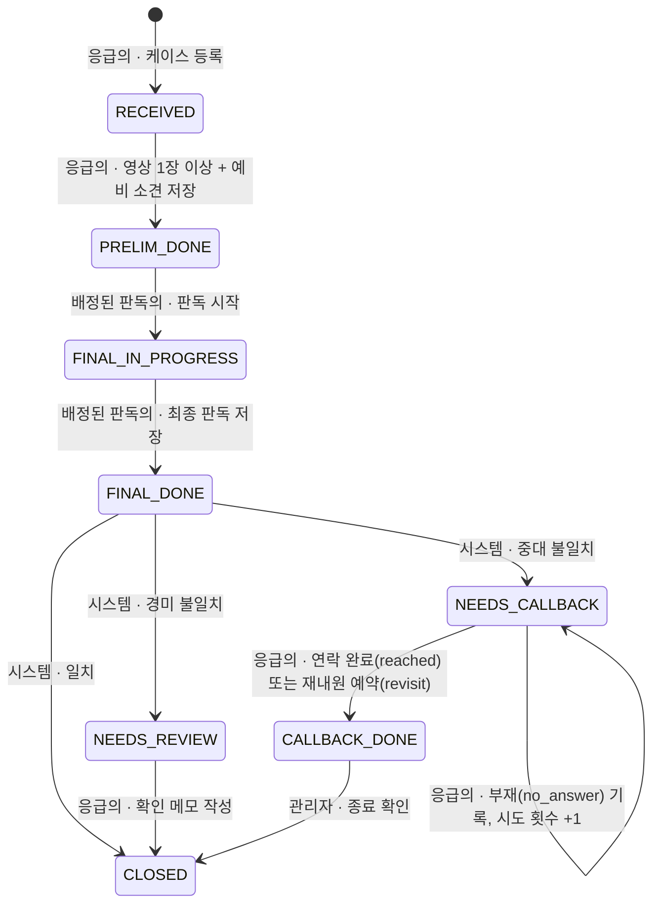

# 상태 전이·권한·불일치 판정 규칙

- 담당: 예찬 (`workflow/state.py`, `workflow/discrepancy.py`, `workflow/readings.py`)
- 상태: 초안 (팀 회의에서 확정)
- 상태 값은 `workflow/state.py`의 상수를 그대로 쓴다. 이 문서는 그 값의 의미와 규칙을 정한다.

> **표기**
> - **[합의]** 11/17 역할·기능 정리 회의록 또는 뼈대 코드(`workflow/state.py`)에 이미 있는 내용
> - **[안내문]** 과제 안내문의 필수 요구사항
> - **[제안]** 이번 초안에서 새로 제안하는 내용. 회의에서 확정 전까지는 바뀔 수 있음

---

## 1. 설계 원칙

| 원칙 | 내용 | 근거 |
| --- | --- | --- |
| 기록은 지우지 않는다 | 소견 수정은 덮어쓰지 않고 `revisions`에 이전 값을 남긴다 | [안내문] 2·3쪽, [합의] |
| 권한은 서버 코드에서 검사 | 화면에서 버튼을 숨기는 것과 별개로 저장·상태 변경 함수 안에서 역할을 다시 검사한다 | [안내문] 3쪽, [합의] |
| 허용되지 않은 전환·중복 실행 거절 | 전환표에 없는 전환과 같은 요청의 연속 실행을 거절한다 | [안내문] 9쪽, [합의] |
| 예비 소견은 잠근다 | 최종 판독이 시작되면 예비 소견은 수정할 수 없다. 불일치를 숨기려고 예비 소견을 고치는 것을 막는다 | [제안] |
| 판정 결과 전환은 시스템만 | 불일치 판정에 따른 전환은 코드만 수행한다. 사람이 "일치"로 임의 종료하는 것을 막는다 | [제안] |

---

## 2. 상태 전이도

상태 8개와 큰 흐름은 [합의]. 각 화살표의 실행 주체·조건 중 [제안]은 3절 표에 표시했다.

### 최종 판독 수정 (재비교) [합의]

`FINAL_DONE`, `NEEDS_REVIEW`, `NEEDS_CALLBACK`, `CALLBACK_DONE`, `CLOSED` 상태에서 판독의가 최종 판독을 수정하면:

1. 이전 값을 `revisions`에 남긴다.
2. 예비 소견과 **다시 비교**한다.
3. 결과에 따라 상태를 다시 정한다. [제안: 아래 세부 규칙]
   - 새로 중대 불일치 → `NEEDS_CALLBACK` (종료됐던 케이스도 다시 열림, 재알림)
   - 새로 경미 불일치 → `NEEDS_REVIEW`
   - 일치가 됨 → `CLOSED` (이미 재연락을 마친 경우에도 기록은 남는다)

---

## 3. 전환표 (코드의 `can_transition()`이 이 표를 그대로 따른다)

| 현재 상태 | 다음 상태 | 실행 주체 | 조건 | 근거 |
| --- | --- | --- | --- | --- |
| (없음) | RECEIVED | 응급의 | 모의 환자 ID, 내원 일시 입력 | [합의] |
| RECEIVED | PRELIM_DONE | 응급의 | 영상 1장 이상 등록, 예비 소견 저장 | [합의] / 영상 1장 이상 조건은 [제안] |
| PRELIM_DONE | FINAL_IN_PROGRESS | 판독의 | 관리자가 이 판독의를 담당자로 배정함 | [합의] 관리자 배정 / 배정된 본인만 시작은 [제안] |
| FINAL_IN_PROGRESS | FINAL_DONE | 판독의 | 배정된 본인, 최종 판독 저장 | [합의] / 배정된 본인 조건은 [제안] |
| FINAL_DONE | CLOSED / NEEDS_REVIEW / NEEDS_CALLBACK | 시스템 | 불일치 판정 결과 (5절) | [합의] / 시스템만 수행은 [제안] |
| NEEDS_REVIEW | CLOSED | 응급의 | 확인 메모 필수 | [제안] |
| NEEDS_CALLBACK | CALLBACK_DONE | 응급의 | 결과가 `reached` 또는 `revisit` | [합의] |
| CALLBACK_DONE | CLOSED | 관리자 | 재연락 기록 확인 | [제안] |
| 완료 이후 상태들 | 재비교 결과 상태 | 판독의 | 최종 판독 수정 (2절) | [합의] |

**표에 없는 전환은 모두 거절**하고 이유를 돌려준다. [안내문] 9쪽. 예:

| 시도 | 결과 | 안내 문구 |
| --- | --- | --- |
| RECEIVED → FINAL_DONE | 거절 | 예비 판독 없이 최종 판독을 완료할 수 없습니다 |
| 응급의가 최종 판독 저장 | 거절 | 최종 판독은 판독의만 입력할 수 있습니다 |
| 배정되지 않은 판독의가 판독 시작 | 거절 | 이 케이스의 담당 판독의가 아닙니다 |
| 사람이 FINAL_DONE → CLOSED | 거절 | 판정 결과에 따른 전환은 시스템만 수행합니다 |
| 재연락 기록 없이 NEEDS_CALLBACK → CLOSED | 거절 | 재연락 결과를 기록해야 종료할 수 있습니다 |
| 같은 전환을 연속 두 번 실행 | 두 번째는 거절 | 이미 처리된 요청입니다 |

---

## 4. 역할별 권한

| 동작 | 응급의 `er` | 판독의 `radiologist` | 관리자 `admin` | 근거 |
| --- | :---: | :---: | :---: | --- |
| 케이스 등록, 영상 업로드 | ✅ | ❌ | ❌ | [합의] |
| 예비 소견 입력 | ✅ | ❌ | ❌ | [합의] |
| 예비 소견 수정 (최종 판독 시작 전까지만) | ✅ | ❌ | ❌ | [합의] 판독의 수정 불가 / 시작 후 잠금은 [제안] |
| 최종 판독 입력·수정 | ❌ | ✅ | ❌ | [합의] / 배정된 본인만은 [제안] |
| 경미 불일치 확인 메모 | ✅ | ❌ | ❌ | [제안] |
| 재연락 결과 기록 | ✅ | ❌ | ❌ | [합의] |
| 판독의 배정 | ❌ | ❌ | ✅ | [합의] |
| 재연락 완료 케이스 종료 확인 | ❌ | ❌ | ✅ | [제안] |
| 불일치·재연락 현황 대시보드 | ❌ | ❌ | ✅ | [합의] |
| 케이스·영상·판독 조회, 강조 보기 | ✅ | ✅ | ✅ | [합의] |
| 소견 내용 수정 | — | — | ❌ | [합의] |

---

## 5. 불일치 판정 규칙 (`compare_readings()`)

### 한 줄 요약 [제안: 아래 판정표를 한 문장으로 정리한 것]

> **기흉 자체를 놓쳤거나 다른 쪽을 봤으면 "중대".**
> 기흉을 이미 알아봤고 정도(확신·크기)만 다르거나, 실제보다 더 심각하게 봤으면 "경미".

### 입력 값 [합의: 뼈대 코드 `workflow/state.py`]

- `finding`: `absent`(없음), `suspected`(의심), `present`(있음)
- `side`: `left`, `right`, `both`, `none`
- `size`: `small`, `large`

### 판정표

| # | 예비 → 최종 | 등급 | 이유 | 근거 |
| --- | --- | --- | --- | --- |
| 1 | 없음 → 있음 | **중대** | 기흉을 놓치고 귀가시킴. 이 프로젝트의 핵심 상황 | [합의] |
| 2 | 없음 → 의심 | **중대** | 판독의가 기흉 가능성을 제기했는데 환자는 이미 귀가함 | [제안] |
| 3 | 의심 → 있음 | 경미 | 응급의도 이미 의심했음. 확인만 필요 | [합의] |
| 4 | 있음 → 없음, 의심 → 없음, 있음 → 의심 | 경미 | 과대 판정. 놓친 것은 없지만 불필요한 처치 여부 확인 | [제안] |
| 5 | 둘 다 있음·의심인데 좌우가 반대 (좌 → 우, 우 → 좌) | **중대** | 반대쪽을 봄. 반대쪽 처치 위험 | [합의] |
| 6 | 둘 다 있음·의심인데 한쪽을 놓침 (좌 → 양쪽, 우 → 양쪽) | **중대** | 한쪽 기흉을 놓침 | [제안] (5번의 확장) |
| 7 | 둘 다 있음·의심인데 예비가 더 넓게 봄 (양쪽 → 좌, 양쪽 → 우) | 경미 | 과대 판정 | [제안] |
| 8 | 둘 다 있음, 같은 쪽, 크기만 다름 (작음 ↔ 큼) | 경미 | 기흉과 위치는 맞게 봄 | [합의] |
| 9 | 모든 값이 같음 | 일치 | 자동 종료 | [합의] |

- 여러 항목이 동시에 다르면 **가장 높은 등급**을 쓰고, 다른 항목은 모두 `fields`에 담는다. [제안]
  - 예: 좌·작음 → 우·큼 = 5번(중대) + 8번(경미) → `{"grade": "major", "fields": ["side", "size"]}`

### 잘못된 입력 (저장 전에 거절) [제안]

| 입력 | 안내 문구 |
| --- | --- |
| `finding=absent`인데 `side`가 `none`이 아님 | 기흉이 없으면 좌우를 선택할 수 없습니다 |
| `finding=present`인데 `side=none` | 기흉이 있으면 좌우를 선택해야 합니다 |
| `finding=present`인데 `size` 없음 | 기흉이 있으면 크기를 선택해야 합니다 |
| 정해진 값이 아닌 문자열 | 허용되지 않은 값입니다 |

---

## 6. 재연락 규칙 (`record_callback()`)

| 항목 | 규칙 | 근거 |
| --- | --- | --- |
| 결과 값 | `reached`(연락 완료), `no_answer`(부재), `revisit`(재내원 예약) | [합의] |
| `reached` / `revisit` | `CALLBACK_DONE`으로 전환 | [합의] |
| `no_answer` | 상태 유지, 시도 횟수와 시각 기록. 다시 시도해야 함 | [제안] |
| 기한 `due_at` | 중대 불일치 판정 시각 + 24시간 (모의 기준, 보고서에 "교육용 가정"으로 명시) | [제안] 숫자는 임의 값 |
| 기한 초과 | 관리자 화면 경고 목록에 표시 (선택 기능, 4주차) | [합의] |

---

## 7. 자동화 테스트 목록 [안내문 9쪽: 상태 규칙은 자동화 테스트로 확인]

- 판정표 1~9번 각각 1개 이상
- 잘못된 입력 4종 거절
- 허용되지 않은 전환 거절 (3절 예시 6종)
- 역할이 맞지 않는 요청 거절
- 최종 판독 수정 시 재비교: 일치 → 중대로 바뀌면 다시 열림
- 같은 전환 연속 실행 시 중복 기록이 생기지 않음

---

## 8. 팀 합의가 필요한 것

**코드 구조**

1. **`change_state()`에 사용자 정보 추가**: 지금 초안은 `change_state(case_id, to_state)`라서 누가 바꾸는지 알 수 없다. `change_state(case_id, to_state, user)`로 바꾸자. (공통 함수라 두 명 모두 리뷰)
2. **판독의 배정 필드**: `cases`에 `assigned_radiologist_uid`를 추가하자. (채민 Firestore 구조와 맞추기)
3. **상태 변경 이력 위치**: `cases/{caseId}/history` 하위 컬렉션에 (이전 상태, 다음 상태, 실행자, 시각, 이유)를 남기자.

**판정 규칙**

4. **크기 작음 → 큼을 중대로 올릴지**: 회의록은 "크기만 다름 = 경미"(판정표 8번). 큰 기흉은 처치가 필요할 수 있어 작다고 보고 귀가시켰다면 위험할 수 있다는 의견. 근거 자료 확인 후 결정하자.
5. **[제안] 표시된 나머지 항목**: 특히 판정표 2·4·6·7번, 재연락 기한 24시간.
